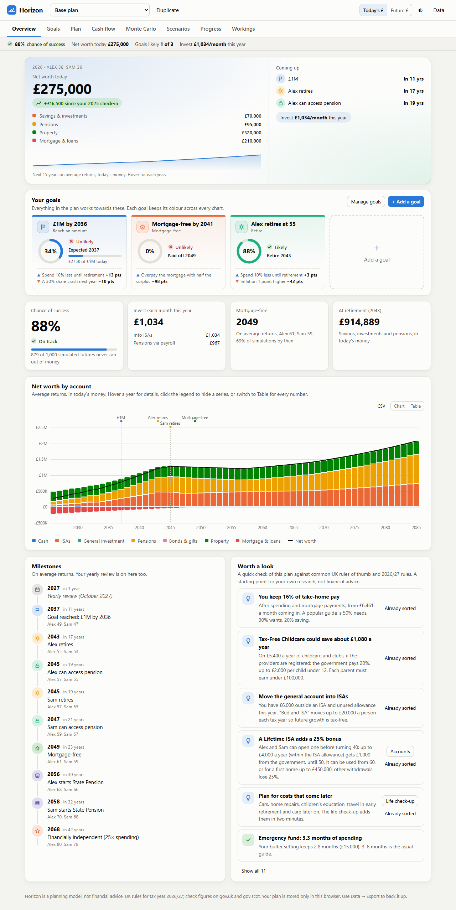

# Horizon

A private, local-first financial planner for UK households, with Scottish and rest-of-UK
tax rules. Inspired by tools like ProjectionLab, but nothing you enter ever leaves your
browser: there is no server, no account and no tracking, and the page is blocked from
making network requests.



## What it does

- **Household plan for one or two people.** Salaries (gross or take-home), workplace
  pensions with employer contributions and salary sacrifice, rental and other income,
  State Pension, spending, one-off events, and accounts: cash, ISAs, general investment
  account, pensions, bonds and gilts, property and mortgages.
- **UK tax, 2026/27.** Scottish or rest-of-UK income tax bands, personal allowance taper,
  National Insurance, capital gains tax, 25% tax-free pension cash, minimum pension age 57,
  frozen thresholds until April 2031, and the salary sacrifice NI cap from April 2029.
- **Year-by-year projection** of every account, with cash flow showing where money comes
  from and where it goes.
- **Saving strategy.** Surplus fills a cash buffer, then optional mortgage overpayments,
  then ISAs (up to the allowance), then a general investment account. In retirement it draws
  tax-efficiently: pensions within the personal allowance first, then GIA, ISA, and more pension.
- **Monte Carlo simulation of a whole economy.** Each simulated future draws its own stock
  and bond returns, inflation (with persistence), salary growth, house prices and interest
  rates (mortgages move after their fixed period ends). Fan charts show the range for each,
  and every one can be switched off or tuned.
- **Goals at the centre.** Retirement, emergency fund, mortgage-free, financial independence,
  an amount by a year, passive income, house deposit, university fund, big purchase, leaving
  an inheritance, or saving for anything else. Each goal has its own name, colour and icon
  badge, used on every chart; the Overview leads with them (chance, progress, expected date).
  Add or remove goals at any time; each has "what would it take" (the overpayment share,
  spending cut, cash buffer or retirement spending that gets you there).
- **What moves your goals.** A heatmap shows how typical choices (retire later or earlier,
  spend less now or in retirement, pay more into pensions, overpay the mortgage) and risks
  (weaker markets, higher inflation, a crash next year) change the chance of every goal.
  Each goal tile names its biggest help and biggest risk.
- **Scenario ideas.** One click adds a ready-made "what if" as a scenario: retire earlier or
  later, part-time work, a year out, six months out of work, a new baby, a market crash,
  lower returns, higher inflation, a higher rate when the mortgage fix ends, overpaying,
  spending less, selling a property, or care costs later in life.
- **Levers with trade-offs.** Sliders for retirement ages, spending in retirement, spending
  now, extra pension saving, mortgage overpayments and lump sums, stock allocation, selling a
  property, and stress tests. A side-by-side table shows how every goal moves, so you can see
  that paying the mortgage off faster costs investing, and apply the result or save it as a
  scenario.
- **Workings.** Spreadsheet-style tables and charts for assumptions, income, spending, tax per
  person and each account's roll-forward (start + growth + in − out = end, checked on every
  row), each downloadable as CSV. Income items show their typical trend range.
- **Scenarios.** Duplicate the plan and change anything, or run a range on one lever
  (mortgage overpayment share, retirement age, spending, returns, inflation) and compare.
- **Yearly review (every October).** A guided walk through every balance, income and
  spending item, each prefilled with what last year's plan expected so you only correct what
  changed. It shows how far you are ahead of or behind last year's prediction, which accounts
  made the difference, and how each goal moved. It then rolls every scenario forward,
  growing amounts the way the plan expected and keeping each scenario's own assumptions,
  and gives this year's "invest each month" figure. A banner reminds you from October. Quick
  check-ins and hand-entered past years are still there.
- **Charts you can check.** Every chart has a Chart/Table switch showing the exact numbers
  behind it (with CSV download), legend items that hide and show series, hover and keyboard
  tooltips, goal lines and milestone markers.
- **Plan check.** "Worth a look" tests the plan against common UK rules of thumb and
  2026/27 rules: emergency fund, saving rate, Child Benefit and the £60k–£80k charge,
  Tax-Free Childcare, the £100k tax trap, ISA allowances, overpaying vs investing, PLSA
  retirement living standards and how much wealth is tied up in property.
- **Life check-up.** A second questionnaire for the big costs that come with time:
  children (school, university, first car, wedding, house deposit), replacing cars, major
  home repairs, active early retirement, spending less later on, care in later life and
  helping family. Answers become dated spending items and events you can review.
- **Flexible income.** Salaries before tax or take-home, rent with exchange rate, costs and a
  flat tax, gifts with no tax, and defined benefit pensions (USS, NHS, teachers): what is
  built up so far plus what each further year adds, with any automatic lump sum. Tax can be
  switched off for the whole household.
- **More goal types.** Save for something by a year (e.g. university), passive income
  of £X a year by a year (a withdrawal rate on investments plus rent and pensions), and an
  emergency fund (months of spending and mortgage payments, in cash only or counting ISAs
  and investments, with the risk that markets are down when you need them).
- **Retirement questionnaire.** Retirement ages for each person, spending in retirement
  (your list, the PLSA minimum/moderate/comfortable standards, or your own figure), extra
  for the active early years, spending less later, and State Pension forecasts, with a live
  chance of success, range chart, earliest age and affordable spending.
- **Mortgage renewal.** When a fixed rate ends: the expected new rate, and whether the
  payment stays the same (the end date moves) or is reset to keep the end date. A Scenarios
  range and a slider try other rates.
- **Pension estimates.** For defined benefit schemes (USS, SAUL, LGPS Scotland, Scottish
  teachers, NHS Scotland) estimate what is built up from the year you joined and your salary.
- **Fees.** Fund and platform charges are taken off investment and pension growth.
- **Replaying history.** The plan is run from every starting year since 1928 using that
  period's real share and bond returns (US market, Damodaran/NYU) with UK inflation (ONS
  RPI) from the same years: how many starts the money survives, the toughest and kindest,
  famous stretches (1929, 1966, 1973, 2000, 2008) against the range, and each goal.
  `npm run update-history` refreshes `data/history.js`.
- **Lifetime ISA.** 25% bonus on up to £4,000 a year inside the ISA allowance, paid in until
  50 (opened before 40), for retirement from 60 or a first home; other withdrawals lose 25%.
- **Higher-rate pension relief.** Extra pension saving from take-home pay claims back tax
  above 20% (Scottish 21–48%, or 40–45%), including the £100k personal allowance trap.
- **Gilts in an ISA.** Bonds and gilts can be marked as held in an ISA, so maturing money
  stays sheltered without using the year's allowance.
- **Spending check-up.** A guided questionnaire that walks through home, food, transport,
  children, personal, subscriptions and holidays, pre-filled from your current spending.
  Each question shows a typical UK range scaled to your household (ONS Family Spending,
  Ofgem's price cap and common rules of thumb), and the summary compares your spending
  with the 50/30/20 guide and the average UK household.
- **Latest market data.** Bank Rate, CPI and 10-year gilt yields are bundled in
  `data/market.js` and refreshed weekly by a GitHub Action, with suggested planning
  assumptions you can apply in one click.

## Use it

Open `index.html` in a browser. That's it: no build step, no install. It opens with a
fictional example household; **Data → Start a blank plan** starts your own from scratch.

Your plan is saved in the browser's local storage. **Data → Export** saves everything
(scenarios, goals, check-ins and display settings) to one JSON file, and **Data → Import**
loads it back, on this or another device.

`plans/example.json` is the fictional example, ready to import. Keep your own plan next to
it as `plans/my-plan.json`: that name (and any `horizon-plan-*.json` export) is in
`.gitignore`, so real figures never end up in the repository.

### Matching a spreadsheet

To reproduce a simple spreadsheet exactly, use the same simplifications it does:

- Household → switch **Work out UK tax** off and enter take-home pay.
- Markets → **Use your own return** for investments and pensions (e.g. 10% and 7%).
- Set cash interest to 0 and the cash buffer to 0 so every penny of surplus is invested.
- Enter rent with its exchange rate, costs (%) and a flat tax rate, as in the sheet.

The Workings tab then shows the same year-by-year numbers, with a CSV download to compare.

## Develop

```sh
npm install
npm test               # unit tests (Node's built-in runner)
npm run test:e2e       # browser tests with Playwright
npm run screenshots    # capture every view, light and dark, desktop and phone
npm run update-market  # refresh data/market.js from the Bank of England and ONS
```

On Windows the browser tests use the installed Microsoft Edge. Elsewhere run
`npx playwright install chromium` once first.

### Layout

| Path | What it is |
|---|---|
| `index.html` | The page |
| `src/uk-rules.js` | Every UK tax number for the tax year, in one place |
| `src/engine.js` | Economy model, projection, Monte Carlo, goals, solvers, sweeps and check-ins. Pure functions, no DOM |
| `src/spending-wizard.js` | Spending check-up questions and how answers map to expenses |
| `src/benchmarks.js` | Typical UK spending ranges and the plan check ("worth a look") |
| `src/scenario-ideas.js` | "What moves your goals" drivers and the ready-made scenario ideas |
| `src/review.js` | The yearly review: roll forward, expected values, comparison, apply to scenarios |
| `src/life-wizard.js` | Life check-up: costs that come with time |
| `src/levers.js` | The levers, how they change a plan, and goal-by-goal comparisons |
| `src/chart.js` | Small canvas chart library (stacked columns, bands, lines, areas, tooltips, table view) |
| `src/app.js` | The interface |
| `data/market.js` | Bundled market data |
| `scripts/update-market-data.mjs` | Fetches Bank Rate, CPI and gilt yields |
| `test/unit`, `test/e2e` | Tests |

### Updating for a new tax year

Change the numbers in `src/uk-rules.js`, update the expectations in
`test/unit/uk-rules.test.js`, and run the tests.

## Limitations

Horizon is a planning model, not financial advice. It does not model dividend or savings
interest tax, property income tax, inheritance tax (including pensions from April 2027),
the tapered annual allowance, the Pension Tax Allowance, or the effect of mortality. Stocks
and bonds are drawn independently of each other and of inflation, all properties share one
house-price swing per year, and mortgage payments stay fixed when rates change.
